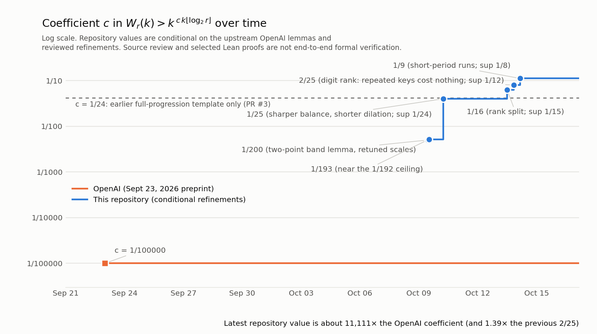

# Tweet draft, October 13, 2026, PR #7 (ELI25)

**Post:**

Van der Waerden numbers, one more round. PR #6 got the coefficient c to 1/16. Today's PR (conditionally) reaches c = 1/9: about 11,111× OpenAI's 1/100000, and every c < 1/8 works.

Two steps, both about counting the ways to fail more cleverly. 🧵

---

**Thread, 1/4.** Recap: a coloring fails if some k-term progression is one color. Random "flips" of keys rule each progression out. The proof wins when the number of ways to fail, times the chance of each, goes to zero.

**2/4.** Step 1, c = 2/25. The 1/16 argument paid twice per hidden direction on one side and saved only once on the other. In base-q digits, both sides share one number R: one side costs R, the other 2D − R. The sum is always 2D, so repeated keys stop costing anything.

**3/4.** Step 2, c = 1/9. Progressions that aren't "rich" used to be paid for by counting every label word, which capped the flip exponent b at 1/3. But they are short-period: each label shows up as one consecutive run. Writing down D·log²k runs is cheap, so b can approach 1/2.

**4/4.** Result: c < γb/2 with γ < 1/2 and b < 1/2, so every c < 1/8 works, and c = 1/9 is certified in exact arithmetic. Past 1/8 these keys look stuck: it would take a new kind of key or a new flip mechanism.

Caveat: conditional on OpenAI's geometric/counting lemmas and on #4's repeated-key structure (restated with proofs), not independently reviewed by a human, no finite record. Chart + proofs in the repo.

**Character counts:** the top post is 246 characters; each thread entry is under 280.
